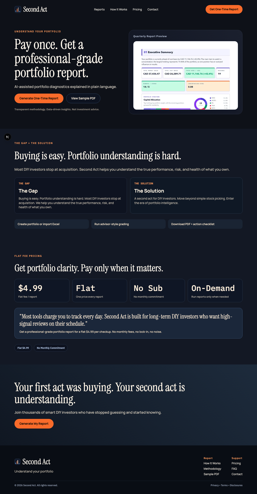
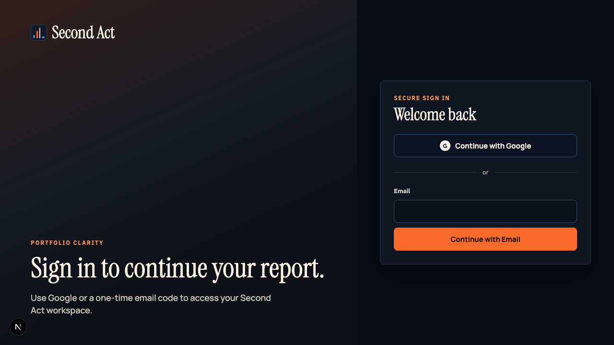
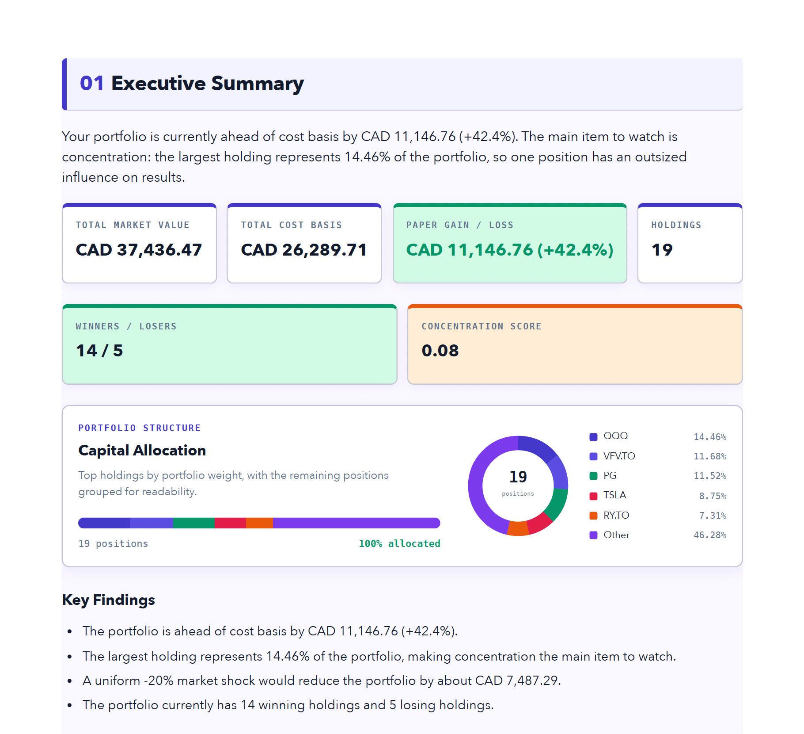
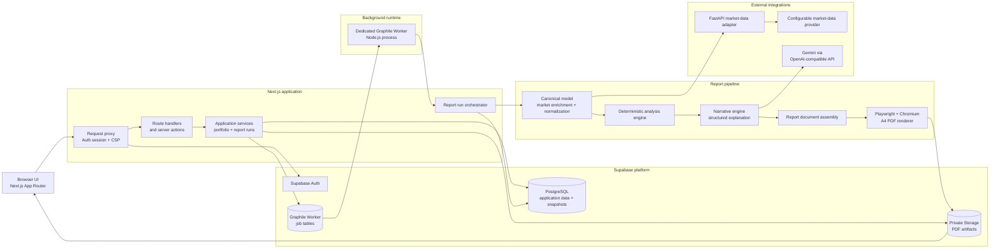

# Second Act

## Product Thesis

Second Act is a report-first, quarterly portfolio checkup product for long-term DIY equity investors who want meaningful portfolio evaluation without a monthly subscription or a daily dashboard habit.

### The post-buy gap

Most investing platforms are designed to help people decide what to buy—the first act of investing. Once those holdings are purchased, investors often have limited access to advisor-style evaluation of the portfolio they actually own.

Second Act addresses that post-buy gap by helping DIY investors understand the performance, risk, structure, and overall health of their portfolios.

### Core product promise

Second Act turns a portfolio into a clear, advisor-style grading report. Users can create a portfolio manually or import one through Excel, run a portfolio checkup, and receive a visually structured PDF with:

- A score and summary of portfolio health
- Key risk flags and concentration observations
- Portfolio structure and allocation diagnostics
- Data-driven findings explained in plain language
- Clear assumptions, methodology, and data-confidence notes

The product is educational and diagnostic. It helps investors understand what they own and what deserves attention; it does not provide individualized investment advice or direct trading instructions.

### Product model

- **Ideal user:** Long-term DIY equity investors who review their portfolios periodically, primarily on a quarterly cadence.
- **Business model:** A one-time payment for each generated report, with no recurring subscription required.
- **Core workflow:** Create or import a portfolio, run a grading checkup, and receive the resulting PDF report.
- **Experience principle:** The report is the core value artifact. Users do not need to depend on a daily dashboard to benefit from the product.
- **Cadence:** Quarterly re-runs and optional reminders support disciplined review while preserving the one-time purchase model.

### Product direction

Second Act is designed around a modular, API-first product boundary. The current experience focuses on one-time portfolio reports, while the underlying product direction leaves room for future broker integrations, additional portfolio-ingestion methods, and alternative report-delivery experiences without changing the product’s central promise:

> Advisor-style portfolio evaluation for DIY investors, delivered when it matters and paid for one report at a time.

## Screenshots

The screenshots below show the public product experience and a representative report artifact. Report values are illustrative and the product is designed for educational diagnostics, not individualized investment advice.

### Landing page

### Sign-in page

### Sample report preview

## Technical Details

Second Act is implemented as a modular application with a Next.js application at its center, a separate market-data adapter, and a dedicated background worker for report generation.

### Technology stack

- **Application layer:** Next.js 16 App Router, React 19, and strict TypeScript.
- **UI:** React Server Components where appropriate, client components for interactive workflows, CSS Modules, and responsive product screens.
- **Authentication:** Supabase Auth with server-side session handling and request-level route protection.
- **Database:** PostgreSQL hosted by Supabase, accessed through Prisma 7 and the PostgreSQL adapter.
- **Object storage:** Private Supabase Storage for generated PDF artifacts, exposed to authorized users through short-lived signed URLs.
- **Background processing:** Graphile Worker using the same PostgreSQL database for durable report jobs and queue state.
- **Market data:** A separate FastAPI service using Pydantic contracts. The current adapter uses `yfinance` behind a provider-neutral interface so the upstream provider can be replaced without changing the report pipeline.
- **Narrative generation:** An OpenAI-compatible chat-completions boundary, currently configured for Gemini. Provider responses are parsed and validated against application-owned schemas.
- **PDF generation:** HTML and CSS report documents rendered to A4 PDF through Playwright and headless Chromium.
- **Validation and testing:** Zod contracts, Vitest unit and integration tests, Python `pytest` tests, ESLint, Prettier, and TypeScript type checking.

### Core technical characteristics

- **Report runs are durable:** A report request is persisted with an explicit lifecycle—`QUEUED`, `PROCESSING`, `COMPLETED`, or `FAILED`—rather than being tied to a single HTTP request.
- **Deterministic calculations are separated from AI prose:** Portfolio valuation, allocation, concentration, gain/loss, stress scenarios, and other diagnostics are calculated by the deterministic analysis engine. The narrative provider explains validated results in plain language; it does not define the underlying numbers.
- **Schema-versioned boundaries:** Market data, canonical snapshots, analysis output, narrative output, and final report documents have explicit contracts and schema versions.
- **Data quality is first-class:** Missing prices, unsupported currencies, stale or partial enrichment, FX problems, and other limitations are carried forward as data-quality flags and surfaced in the report.
- **Provider abstraction:** Market-data and narrative integrations are isolated behind interfaces and normalized contracts, allowing providers to change independently from the domain and reporting layers.
- **Security boundaries are explicit:** User ownership is checked at the API/service layer, application tables deny direct client-role access through PostgreSQL RLS policies, privileged Supabase service-role access remains server-side, and generated PDFs remain in private storage.
- **Report integrity is tracked:** Stored PDF artifacts include metadata such as file size, MIME type, storage path, and an optional SHA-256 checksum.
- **Operational separation:** The web application handles authenticated requests and orchestration; the worker handles long-running report jobs; the market-data adapter isolates external data-provider behavior.

## Architecture

Second Act follows a modular-monolith architecture with two supporting services. PostgreSQL is both the system of record and the durable job queue, while Supabase Auth provides managed identity and Supabase Storage provides private artifact storage.

### Report generation flow

1. An authenticated user creates or selects a portfolio and requests a report in a chosen reporting currency.
2. The application persists a report run and enqueues a durable Graphile Worker job in PostgreSQL.
3. The worker claims the job and moves the run into `PROCESSING`.
4. The canonical-model stage loads the portfolio holdings, requests normalized market data, applies currency conversion, calculates position-level values, and records data-quality flags.
5. The deterministic analysis engine derives portfolio totals, allocation, concentration, gain/loss, benchmark, and stress-scenario metrics.
6. The narrative engine sends a constrained, prompt-ready representation of those validated metrics to the configured language-model provider and validates the structured response.
7. The document builder combines the canonical snapshot, deterministic analysis, narrative output, report metadata, methodology notes, and the system-owned disclaimer.
8. Playwright renders the self-contained HTML report to an A4 PDF and calculates artifact metadata.
9. The PDF is uploaded to private Supabase Storage, its metadata is recorded in PostgreSQL, and the report run is marked `COMPLETED`.
10. The authenticated API returns report status and creates a short-lived signed URL when the owner requests the PDF.
